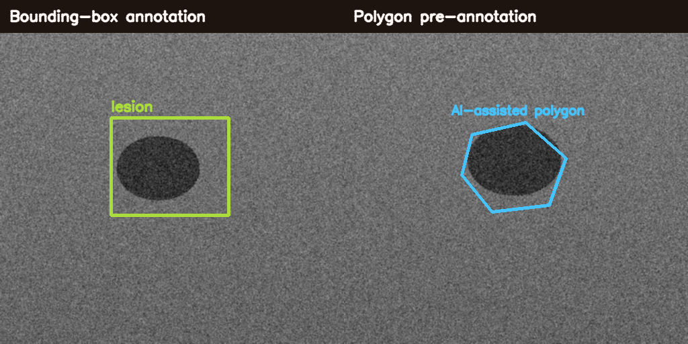

# MedAnnotate AI
### Intelligent Medical Image Annotation & Dataset Management Web Application

MedAnnotate AI is a full-stack research application for **medical-image dataset organization, browser-based annotation, AI-assisted pre-annotation, and dataset export**. It combines a **React** annotation workspace with a **FastAPI** backend, **PostgreSQL** persistence, **OpenCV** image processing, and an optional **PyTorch/MONAI** segmentation model for pre-annotation.

> **Research-use disclaimer:** MedAnnotate AI is a research/data-engineering prototype. It is not a medical device, diagnostic system, or clinical annotation platform validated for patient care. Do not upload protected health information to public deployments.



## Features

### Dataset management
- Create annotation projects
- Define project classes such as `lesion`, `tumour`, `organ`, or `defect`
- Upload PNG/JPG/JPEG/BMP/TIFF images
- Browse project images and annotation counts
- Persistent metadata and annotations in PostgreSQL

### Browser annotation
- Bounding-box annotation
- Polygon annotation
- Class assignment
- Edit workflow through deletion and redraw
- Original-pixel coordinates retained independently of screen size
- Per-image annotation list

### AI-assisted pre-annotation
- **Checkpoint mode:** optional PyTorch/MONAI 2-D segmentation model
- **Demo mode:** deterministic OpenCV heuristic for software demonstration only
- Automatically converts the predicted largest region into a polygon suggestion
- Suggested annotations remain editable and must be explicitly saved by the user

### Dataset export
- COCO-style JSON export
- YOLO bounding-box dataset export (`.zip`) with images, labels, classes, and dataset configuration
- Project summary/statistics endpoint

### Engineering
- FastAPI REST API + Swagger docs
- React/Vite frontend
- PostgreSQL in Docker
- SQLite fallback for zero-configuration local testing
- SQLAlchemy ORM
- Docker Compose
- Backend tests
- Seed/demo image generator

## Architecture

```text
                    +----------------------+
                    |     React / Vite     |
                    | annotation workspace |
                    +----------+-----------+
                               |
                         REST / multipart
                               |
                    +----------v-----------+
                    |       FastAPI        |
                    | projects / images /  |
                    | annotations / export |
                    +----+------------+----+
                         |            |
                         |            +---------------------+
                         |                                  |
                 +-------v--------+                 +-------v--------+
                 | PostgreSQL /   |                 | AI preannotator|
                 | SQLite         |                 | PyTorch/MONAI  |
                 +-------+--------+                 | or demo OpenCV |
                         |                          +----------------+
                         |
                  image / annotation
                     persistence
```

## Repository structure

```text
MedAnnotate-AI/
├── backend/
│   ├── app/
│   │   ├── main.py
│   │   ├── config.py
│   │   ├── database.py
│   │   ├── models.py
│   │   ├── schemas.py
│   │   ├── api.py
│   │   └── services/
│   │       ├── storage.py
│   │       ├── preannotation.py
│   │       └── export.py
│   ├── models/
│   │   └── README.md
│   └── tests/
│       ├── test_health.py
│       └── test_geometry.py
├── frontend/
│   ├── src/
│   │   ├── App.jsx
│   │   ├── api.js
│   │   ├── styles.css
│   │   └── components/
│   │       ├── ProjectPanel.jsx
│   │       ├── ImagePanel.jsx
│   │       └── AnnotationCanvas.jsx
│   ├── package.json
│   ├── vite.config.js
│   └── index.html
├── scripts/
│   └── generate_demo_images.py
├── data/
├── .env.example
├── .gitignore
├── docker-compose.yml
├── Dockerfile.backend
├── Dockerfile.frontend
├── requirements.txt
├── LICENSE
└── CITATION.cff
```

## Quick start with Docker

The easiest way to run the complete PostgreSQL version:

```bash
docker compose up --build
```

Open:

- Frontend: `http://localhost:5173`
- FastAPI docs: `http://localhost:8000/docs`
- API health: `http://localhost:8000/health`

PostgreSQL runs internally through Docker Compose.

## Local development without Docker

The backend automatically falls back to SQLite when `DATABASE_URL` is not set.

### Backend

```bash
python -m venv .venv
```

Activate the environment, then:

```bash
pip install -r requirements.txt
uvicorn backend.app.main:app --reload --port 8000
```

### Frontend

Requires Node.js 20+.

```bash
cd frontend
npm install
npm run dev
```

Open:

```text
http://localhost:5173
```

## Generate synthetic demo images

```bash
python scripts/generate_demo_images.py
```

This creates several **synthetic, non-patient** images in:

```text
data/demo_images/
```

Use them to demonstrate project creation, image upload, manual annotation, AI-assisted pre-annotation, and export.

## Typical workflow

1. Create a project, for example `Breast Ultrasound Lesions`
2. Define classes such as `lesion, cyst, mass`
3. Upload research/demo images
4. Choose `Box` or `Polygon`
5. Draw annotations in the browser
6. Optionally request an AI pre-annotation suggestion
7. Save annotations
8. Review dataset statistics
9. Export to COCO or YOLO format

## Annotation model

Annotations are stored using original-image pixel coordinates.

### Rectangle

```json
{
  "annotation_type": "bbox",
  "label": "lesion",
  "geometry": {
    "x": 120.5,
    "y": 80.0,
    "width": 180.2,
    "height": 130.8
  }
}
```

### Polygon

```json
{
  "annotation_type": "polygon",
  "label": "lesion",
  "geometry": {
    "points": [
      [120.0, 80.0],
      [260.0, 90.0],
      [280.0, 210.0],
      [140.0, 225.0]
    ]
  }
}
```

## AI pre-annotation

### Demo mode

If no model checkpoint is configured, MedAnnotate AI uses a deterministic OpenCV region proposal. This mode is deliberately marked as a **software demonstration**, not as a trained medical prediction.

### Checkpoint mode

Place a checkpoint at:

```text
backend/models/medannotate.pt
```

Set:

```env
MEDANNOTATE_MODEL_PATH=backend/models/medannotate.pt
```

The default adapter expects:

```text
input:  [B, 1, H, W]
output: [B, 1, H, W] logits
```

If your model architecture is different, edit:

```text
backend/app/services/preannotation.py
```

Specifically:

```python
build_model()
predict_checkpoint()
```

## REST API

### Projects

```http
POST /api/projects
GET  /api/projects
GET  /api/projects/{project_id}
```

### Images

```http
POST /api/projects/{project_id}/images
GET  /api/projects/{project_id}/images
GET  /api/images/{image_id}/file
```

### Annotations

```http
POST   /api/images/{image_id}/annotations
GET    /api/images/{image_id}/annotations
DELETE /api/annotations/{annotation_id}
```

### AI suggestion

```http
POST /api/images/{image_id}/preannotate
```

### Export

```http
GET /api/projects/{project_id}/export/coco
GET /api/projects/{project_id}/export/yolo
```

### Statistics

```http
GET /api/projects/{project_id}/stats
```

## GitHub screenshots to add

For a strong portfolio presentation, capture:

1. Project creation screen
2. Uploaded medical-image dataset browser
3. Bounding-box annotation
4. Polygon annotation
5. AI-assisted pre-annotation suggestion
6. Dataset statistics cards
7. COCO/YOLO export controls
8. Swagger API documentation

## Suggested CV entry

**MedAnnotate AI — Intelligent Medical Image Annotation & Dataset Management Web Application**  
Developed a full-stack research platform for medical-image dataset organization, browser-based bounding-box/polygon annotation, AI-assisted pre-annotation, annotation management, dataset statistics, and COCO/YOLO export using React, FastAPI, PostgreSQL, PyTorch/MONAI, and OpenCV.

**Technologies:** React, FastAPI, PostgreSQL, SQLAlchemy, PyTorch, MONAI, OpenCV, Docker

## Testing

Backend:

```bash
pytest backend/tests -q
```

Frontend build:

```bash
cd frontend
npm install
npm run build
```

## Privacy

Do not upload identifiable patient information to public or unsecured deployments. Use de-identified research data and follow the requirements of the data provider, institution, and ethics approval.

## License

MIT License.
